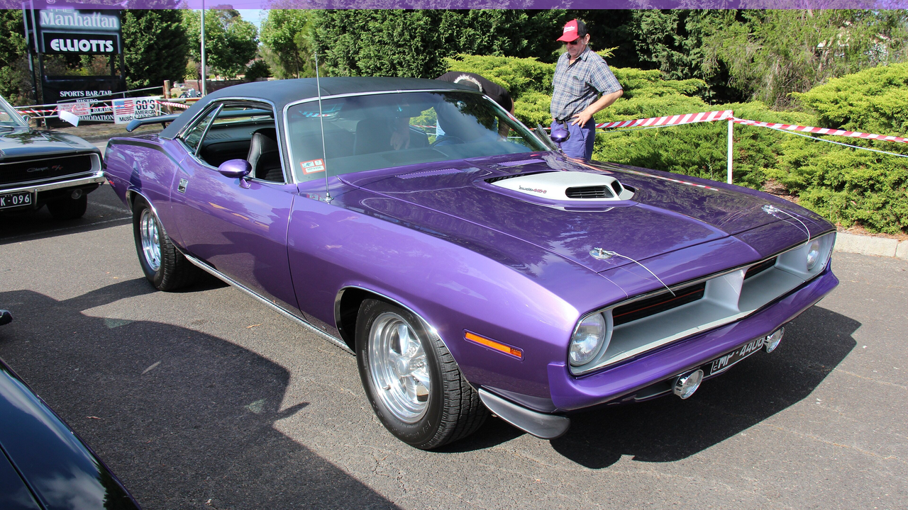

# Plum Crazy

A dark Omarchy theme built from 1970 Plymouth Hemi 'Cuda 440-6 in Plum Crazy (Mopar High Impact).



## What it is

Plum Crazy was Chrysler's High Impact violet for 1970, and it looks like a mistake until you see it on a 'Cuda. The theme keeps the violet bright and drops everything behind it into a deep aubergine.

## Install

```bash
omarchy theme install https://github.com/offback/omarchy-plum-crazy-theme.git
# or, from a local clone:
cp -r omarchy-plum-crazy-theme ~/.config/omarchy/themes/
omarchy theme set plum-crazy
```

## Palette

| Key | Value | |
|---|---|---|
| accent | `#b06cf5` | the paint colour |
| background | `#1c1030` | |
| foreground | `#dcc9f0` | |
| muted | `#6b5486` | |
| selection | `#33184d` | |

Every colour lives in `colors.toml`; Omarchy generates the rest
(Alacritty, btop, Waybar, Hyprland, Neovim, VS Code, Chromium, walker, mako …).

## Wallpapers

| File | Photograph | Licence |
|---|---|---|
| `backgrounds/001-hemi-cuda-plum-crazy.jpg` | [1970 Plymouth Cuda 440-6 (15710887687).jpg](https://commons.wikimedia.org/wiki/File:1970_Plymouth_Cuda_440-6_(15710887687).jpg) | CC BY 2.0 |
| `backgrounds/002-barracuda-plum-crazy.jpg` | [1970 Plymouth Barracuda Gran Coupe (17706743443).jpg](https://commons.wikimedia.org/wiki/File:1970_Plymouth_Barracuda_Gran_Coupe_(17706743443).jpg) | CC BY 2.0 |

Photographs are **not** covered by this theme's MIT licence. See
[ATTRIBUTION.md](ATTRIBUTION.md) for the author, licence and source of each one.

## Licence

MIT for the theme files (`colors.toml`, `preview.png`, `icons.theme`,
`keyboard.rgb`, this README). The wallpaper photographs keep their own licences.
